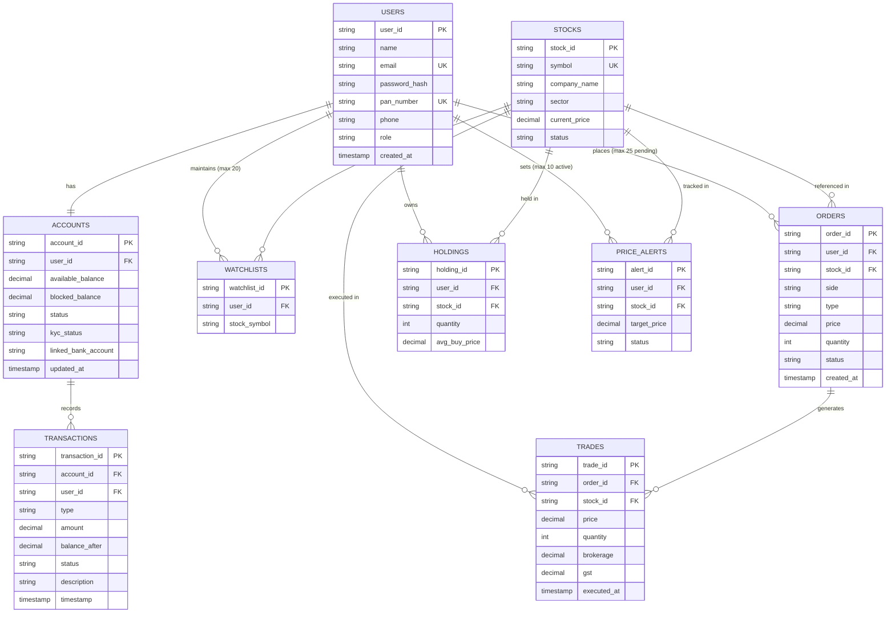
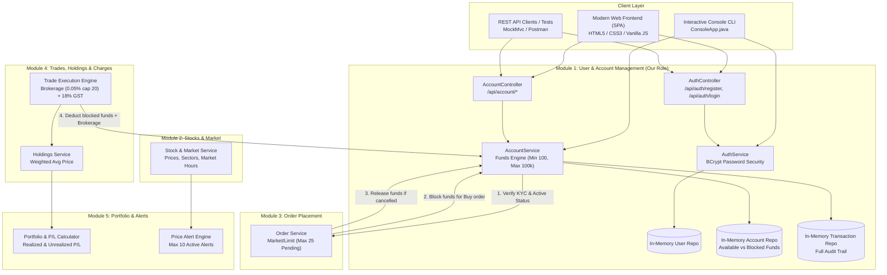

# Stock Trading App — Design & SQL Exercise Solutions

This document provides the solutions to the SQL exercises, Entity-Relationship (ER) diagram, and High-Level System Architecture diagram specified in the Low Level Design (LLD) document.

---

## 🗄️ SQL Exercise Solutions

### Database Schema Context
For the queries below, assume the standard relational schema modeled from the problem statement:
- `users(user_id, name, email, pan_number, phone, role, created_at)`
- `accounts(account_id, user_id, available_balance, blocked_balance, status, kyc_status)`
- `stocks(stock_id, symbol, company_name, sector, current_price, status)`
- `orders(order_id, user_id, stock_id, side, type, price, quantity, status, created_at)`
- `trades(trade_id, order_id, stock_id, buyer_user_id, seller_user_id, price, quantity, executed_at, brokerage, gst)`

---

### Query 1
> **Requirement:** For each sector, find the total number of stocks listed, the total number of executed trades, and the total traded value. Show only sectors that have more than 2 stocks. Sort by total traded value in descending order.

```sql
SELECT 
    s.sector,
    COUNT(DISTINCT s.stock_id) AS total_stocks_listed,
    COUNT(t.trade_id) AS total_executed_trades,
    COALESCE(SUM(t.price * t.quantity), 0.00) AS total_traded_value
FROM 
    stocks s
LEFT JOIN 
    trades t ON s.stock_id = t.stock_id
GROUP BY 
    s.sector
HAVING 
    COUNT(DISTINCT s.stock_id) > 2
ORDER BY 
    total_traded_value DESC;
```

---

### Query 2
> **Requirement:** For each user, list the total number of orders placed, the number of executed orders, and the total brokerage paid. Group the results by user and include only users who have placed at least 3 orders.

```sql
SELECT 
    u.user_id,
    u.name,
    COUNT(o.order_id) AS total_orders_placed,
    COUNT(CASE WHEN o.status = 'EXECUTED' THEN 1 END) AS executed_orders_count,
    COALESCE(SUM(t.brokerage), 0.00) AS total_brokerage_paid
FROM 
    users u
JOIN 
    orders o ON u.user_id = o.user_id
LEFT JOIN 
    trades t ON o.order_id = t.order_id
GROUP BY 
    u.user_id, 
    u.name
HAVING 
    COUNT(o.order_id) >= 3
ORDER BY 
    total_orders_placed DESC;
```

---

### Query 3
> **Requirement:** For each stock, find the total quantity bought, the total quantity sold, and the number of distinct users who traded it. Include only stocks traded by more than 2 distinct users, ordered by total traded quantity in descending order.

```sql
SELECT 
    s.symbol,
    s.company_name,
    COALESCE(SUM(CASE WHEN o.side = 'BUY' THEN t.quantity ELSE 0 END), 0) AS total_quantity_bought,
    COALESCE(SUM(CASE WHEN o.side = 'SELL' THEN t.quantity ELSE 0 END), 0) AS total_quantity_sold,
    COUNT(DISTINCT o.user_id) AS distinct_users_count,
    COALESCE(SUM(t.quantity), 0) AS total_traded_quantity
FROM 
    stocks s
JOIN 
    trades t ON s.stock_id = t.stock_id
JOIN 
    orders o ON t.order_id = o.order_id
GROUP BY 
    s.stock_id, 
    s.symbol, 
    s.company_name
HAVING 
    COUNT(DISTINCT o.user_id) > 2
ORDER BY 
    total_traded_quantity DESC;
```

---

## 📊 Entity Relationship (ER) Diagram



---

## 🏛️ High-Level System Architecture Diagram



