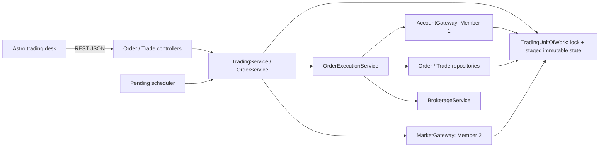
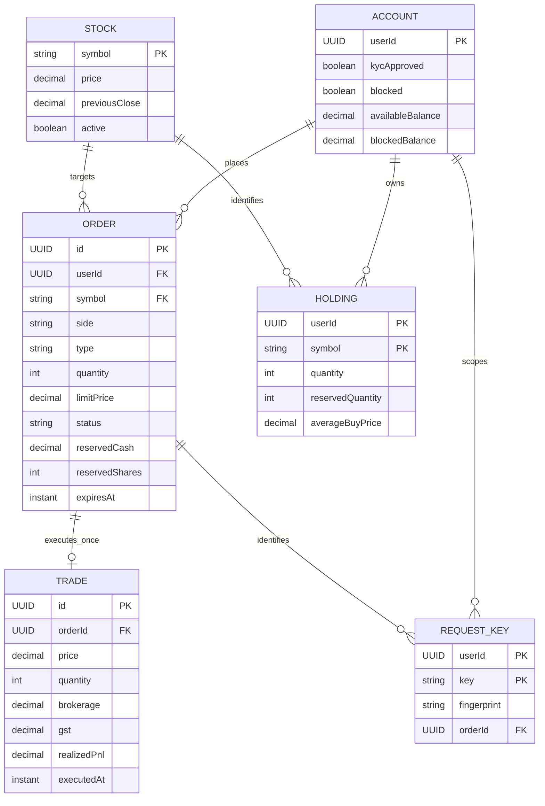

# Trading architecture



```mermaid
sequenceDiagram
    participant User
    participant API
    participant Work as Unit of work
    participant Engine
    participant Account
    participant Ledger as Order / Trade repositories
    User->>API: POST order + user identity + retry key
    API->>Work: Acquire lock; copy maps
    Work->>Engine: Check retry key, expiry, eligibility and quote
    Engine->>Account: Reserve cash + fees OR shares
    Engine->>Ledger: Save pending intent
    alt Quote matches
      Engine->>Account: Settle cash and holdings
      Engine->>Ledger: Save one trade and executed order
    end
    Engine->>Work: Return final immutable response
    alt Successful callback
      Work->>Work: Replace committed state; release lock
      Work-->>API: Order response
      API-->>User: 201 PENDING / EXECUTED / REJECTED
    else Settlement exception
      Work->>Work: Discard staged maps; release lock
      API-->>User: 500; retry with same key
    end
```

The diagram below describes logical entities; **no SQL database is used**. SQL exercises and unrelated modules from the PDF are outside Member 3 scope.



Encapsulation comes from immutable records and gateway/service methods. `ExecutionRule` is an abstract pricing rule with inherited market and limit implementations; the engine dispatches through its common type. Gateways hide account/market storage details. Controllers depend on services rather than collection manipulation.
